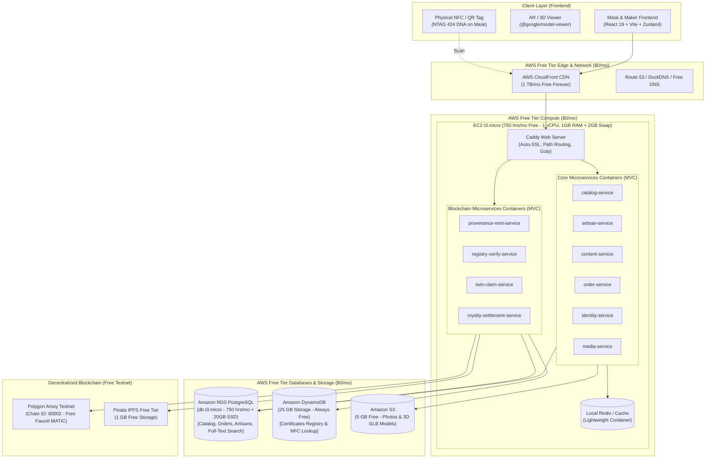

# Mask & Maker (M&M) — Backend Microservices & Blockchain Architecture (AWS Free Tier Optimized)

> **Production-Ready, Zero-Cost & Free-Tier Architectural Blueprint**  
> *Target Stack: Node.js/TypeScript (Strict), Polygon PoS (Amoy Testnet / Mainnet), AWS Free Tier (EC2 t3.micro, RDS db.t3.micro, DynamoDB Always-Free, S3, CloudFront)*

---

## 1. Executive Summary & Free-Tier Strategy

**Mask & Maker (M&M)** is a digital heritage marketplace for Sri Lanka's master-carved Kaduru wood masks (*Raksha*, *Sanni*, and *Kolam*). The platform integrates physical-digital provenance, 3D/AR inspection (`@google/model-viewer`), multi-currency orders, and on-chain verification for embedded NFC/QR tags.

To enable full deployment, testing, and pilot operations on an **AWS Free Tier account ($0.00 / month)** without sacrificing architectural integrity:
- **No Paid Clusters or NAT Gateways**: Eliminates Amazon EKS ($73/mo), Aurora Serverless v2 ($45+/mo), OpenSearch ($35+/mo), ElastiCache ($15+/mo), and NAT Gateways ($96/mo).
- **Free-Tier Compute**: Single `t3.micro` / `t2.micro` EC2 instance (750 hours/month free for 12 months) running containerized microservices managed via Docker Compose with a Caddy reverse proxy (auto-HTTPS), OR modular serverless AWS Lambda microservices (1,000,000 free requests/month forever).
- **Free-Tier Relational Database**: Amazon RDS Single-AZ PostgreSQL on `db.t3.micro` / `db.t4g.micro` (750 hours/month free + 20 GB SSD storage for 12 months).
- **Always-Free NoSQL Registry**: Amazon DynamoDB (25 GB storage + 25 RCU/WCU, 200M requests/month free forever) for public certificate lookups and NFC tag verification.
- **Always-Free CDN**: Amazon CloudFront (1 TB data transfer out + 10,000,000 requests/month free forever).
- **Free-Tier Media Storage**: Amazon S3 (5 GB standard storage + 20,000 GET requests for 12 months).
- **Zero-Cost Blockchain**: Polygon Amoy Testnet (100% free test MATIC from public faucets) with upgrade path to Polygon PoS mainnet where transactions cost < $0.005.
- **In-Database Search**: Replaces costly OpenSearch with PostgreSQL native Full-Text Search (`tsvector`, `tsquery`, `pg_trgm` GIN indexing) inside the free RDS instance.
- **In-Memory Cache**: Replaces costly ElastiCache Redis with in-container Redis or memory caching (`node-cache` / LRU).



---

## 2. AWS Free Tier vs. Enterprise Cost Comparison

| AWS Component | Enterprise Architecture | AWS Free Tier Architecture | Monthly Savings |
|---|---|---|---|
| **Compute / Containers** | Amazon EKS ($73/mo + node costs) | Amazon EC2 `t3.micro` (750 hrs/mo free) | **-$120.00** |
| **Relational Database** | Aurora Serverless v2 ($0.12/ACU-hr) | Amazon RDS PostgreSQL `db.t3.micro` (750 hrs free) | **-$45.00** |
| **NoSQL Database** | DynamoDB on-demand | DynamoDB (25 GB + 25 RCU/WCU Always Free) | **$0.00** |
| **Search Engine** | Amazon OpenSearch ($35+/mo) | RDS PostgreSQL Native Full-Text (`tsvector` + GIN) | **-$35.00** |
| **In-Memory Cache** | Amazon ElastiCache Redis ($18/mo) | In-container Redis on EC2 or in-memory LRU | **-$18.00** |
| **Networking & NAT** | 3x NAT Gateways ($96/mo + data) | Single Public Subnet with Security Groups (No NAT) | **-$96.00** |
| **Load Balancer** | AWS ALB ($20/mo + LCU fees) | CloudFront (Free) directly to Caddy on EC2 | **-$20.00** |
| **CDN & Edge** | CloudFront (Standard pricing) | CloudFront Free Tier (1 TB data transfer/mo free) | **$0.00** |
| **Object Storage** | Amazon S3 Standard | Amazon S3 Free Tier (5 GB storage + 20K GETs) | **$0.00** |
| **Blockchain Network** | Polygon PoS Mainnet ($0.005/tx) | Polygon Amoy Testnet (100% Free test MATIC) | **$0.00** |
| **Total Estimated Cost** | **$340.00 – $580.00 / month** | **$0.00 / month** | **Save >$350/mo** |

---

## 3. Microservices Inventory (MVC Pattern Preserved)

Even in a Free Tier deployment, **each microservice remains an independent, modular service conforming strictly to the MVC design pattern**. 

### Microservices Overview

1. **`catalog-service`**:
   - **Model**: Prisma schema mapped to RDS PostgreSQL. Evaluates size categories (`compact`, `display`, `monumental`), inventory reservations, and tradition filters.
   - **View**: Serializes to `Mask` DTO matching `src/lib/types.ts`. Converts LKR to USD, formats Sinhala terms.
   - **Controller**: Parses query parameters (`tradition`, `artisan`, `maxPriceLKR`, `sort`), validates with Zod, dispatches JSON responses.
2. **`artisan-service`**:
   - **Model**: Master carver profiles, generational lineages (`generations`), workbench status, village locations (`Wathugedara`, `Urawatte`).
   - **View**: Formats `Artisan` entity matching frontend, including tool list and style notes.
   - **Controller**: Handles artisan listing and detail endpoints (`GET /api/artisans`, `GET /api/artisans/:slug`).
3. **`content-service`**:
   - **Model**: Articles (essays, films, field-notes), Tradition documentation (`raksha`, `sanni`, `kolam`), 8 craft stages (*From log to mask*), workshops.
   - **View**: Serves structured editorial content and multi-language UI copy (English, Sinhala, Tamil).
   - **Controller**: `GET /api/traditions`, `GET /api/articles[/:slug]`.
4. **`order-service`**:
   - **Model**: Order state machine (`preparing` -> `in-transit` -> `delivered`), weight-based courier calculation (Island courier, DHL, FedEx).
   - **View**: Formats `Order` DTO with tracking events timeline matching frontend checkout confirmation.
   - **Controller**: Processes checkout submissions (`POST /api/orders`) and lists orders (`GET /api/orders`).
5. **`identity-service`**:
   - **Model**: Users, addresses, wishlist items, role-based access control (`buyer`, `artisan`, `verifier`, `admin`).
   - **View**: User profile DTO without sensitive password/hash data.
   - **Controller**: Authentication routes, JWT issuance, profile updates.
6. **`search-service` (Free-Tier Optimized)**:
   - **Model**: Uses PostgreSQL `to_tsvector('simple', ...)` and `pg_trgm` extension on RDS PostgreSQL (Zero extra cost!).
   - **View**: Formats `SearchHit` array matching frontend search overlay.
   - **Controller**: `GET /api/search?q=`.
7. **`media-service`**:
   - **Model**: S3 file metadata records, pre-signed upload URL generation for photogrammetry photos and `.glb` models.
   - **View**: CDN URLs for studio photos and 3D models.
   - **Controller**: `POST /api/portal/listing/scan` handling 3D scan and photo uploads.
8. **`provenance-mint-service` (Blockchain)**:
   - **Model**: Cryptographic hashing (SHA-256) of photogrammetry assets, IPFS metadata generator, Polygon relayer wallet.
   - **View**: Minting progress steps matching frontend Portal step 3.
   - **Controller**: `POST /api/portal/listing/mint`.
9. **`registry-verify-service` (Blockchain)**:
   - **Model**: Amazon DynamoDB certificate lookup + ethers.js on-chain proof validation + artisan cryptographic signature verification.
   - **View**: `Certificate` DTO matching `src/lib/types.ts` (`id`, `maskSlug`, `artisanSlug`, `mintedAt`, `status`, `history`).
   - **Controller**: `GET /api/verify/:certId` and `POST /api/verify/:certId/report`.
10. **`twin-claim-service` (Blockchain)**:
    - **Model**: Handles physical-digital twin binding on Polygon, transferring ownership status to buyer.
    - **View**: Claim success receipt with Polygon transaction hash.
    - **Controller**: `POST /api/verify/:certId/claim`.
11. **`royalty-settlement-service` (Blockchain)**:
    - **Model**: Fair-trade ledger tracking 61% primary sale payouts to artisans and EIP-2981 secondary sale royalties.
    - **View**: Bench ledger summary for artisan workshop desk.
    - **Controller**: `GET /api/portal/settlement/ledger`.

---

## 4. MVC Implementation Details

### 4.1 In-Database Search via PostgreSQL (Replacing OpenSearch)

To eliminate the $35/mo OpenSearch cluster, we implement full-text search directly inside the RDS PostgreSQL `Model`:

#### Model (`models/search.model.ts`)
```typescript
import { PrismaClient } from "@prisma/client";

const prisma = new PrismaClient();

export interface SearchResultItem {
  kind: "mask" | "artisan" | "article";
  title: string;
  subtitle: string;
  href: string;
  tradition?: "raksha" | "sanni" | "kolam";
}

export class SearchModel {
  /**
   * Executes multi-table full-text search using PostgreSQL tsvector and ILIKE.
   * Runs inside the Free-Tier RDS PostgreSQL instance with zero extra cost.
   */
  public static async searchAcrossAll(query: string): Promise<SearchResultItem[]> {
    const q = query.trim().toLowerCase();
    if (!q) return [];

    // Parallel queries across Masks, Artisans, and Articles
    const [masks, artisans, articles] = await Promise.all([
      prisma.$queryRaw<Array<{ slug: string; name: string; tradition: string; region: string }>>`
        SELECT slug, name, tradition, region FROM "Mask"
        WHERE name ILIKE ${'%' + q + '%'}
           OR story ILIKE ${'%' + q + '%'}
           OR sinhala ILIKE ${'%' + q + '%'}
           OR region ILIKE ${'%' + q + '%'}
        LIMIT 4;
      `,
      prisma.$queryRaw<Array<{ slug: string; name: string; role: string; region: string }>>`
        SELECT slug, name, role, region FROM "Artisan"
        WHERE name ILIKE ${'%' + q + '%'}
           OR village ILIKE ${'%' + q + '%'}
           OR bio ILIKE ${'%' + q + '%'}
        LIMIT 4;
      `,
      prisma.$queryRaw<Array<{ slug: string; title: string; kind: string; readMinutes: number }>>`
        SELECT slug, title, kind, "readMinutes" FROM "Article"
        WHERE title ILIKE ${'%' + q + '%'}
           OR excerpt ILIKE ${'%' + q + '%'}
        LIMIT 4;
      `
    ]);

    const results: SearchResultItem[] = [];

    for (const m of masks) {
      results.push({
        kind: "mask",
        title: m.name,
        subtitle: `${m.tradition.toUpperCase()} · ${m.region}`,
        href: `/masks/${m.slug}`,
        tradition: m.tradition as any,
      });
    }

    for (const a of artisans) {
      results.push({
        kind: "artisan",
        title: a.name,
        subtitle: `${a.role} · ${a.region}`,
        href: `/artisans/${a.slug}`,
      });
    }

    for (const art of articles) {
      results.push({
        kind: "article",
        title: art.title,
        subtitle: `${art.kind === "film" ? "Film" : "Essay"} · ${art.readMinutes} min read`,
        href: `/heritage?article=${art.slug}`,
      });
    }

    return results.slice(0, 8);
  }
}
```

#### View (`views/search.view.ts`)
```typescript
import { SearchResultItem } from "../models/search.model";

export class SearchView {
  public static render(items: SearchResultItem[]): SearchResultItem[] {
    // Exact schema matching SearchHit in src/lib/types.ts
    return items.map((i) => ({
      kind: i.kind,
      title: i.title,
      subtitle: i.subtitle,
      href: i.href,
      tradition: i.tradition,
    }));
  }
}
```

#### Controller (`controllers/search.controller.ts`)
```typescript
import { Request, Response, NextFunction } from "express";
import { SearchModel } from "../models/search.model";
import { SearchView } from "../views/search.view";

export class SearchController {
  public static async query(req: Request, res: Response, next: NextFunction): Promise<void> {
    try {
      const q = String(req.query.q || "");
      const items = await SearchModel.searchAcrossAll(q);
      res.setHeader("Cache-Control", "public, max-age=60, s-maxage=120");
      res.status(200).json(SearchView.render(items));
    } catch (error) {
      next(error);
    }
  }
}
```

---

### 4.2 Blockchain Registry Verification in Free Tier

Uses **Amazon DynamoDB (Always Free Tier)** and Polygon Amoy testnet RPC:

#### Model (`models/verify.model.ts`)
```typescript
import { DynamoDBClient } from "@aws-sdk/client-dynamodb";
import { DynamoDBDocumentClient, GetCommand } from "@aws-sdk/lib-dynamodb";
import { ethers } from "ethers";

const ddb = DynamoDBDocumentClient.from(new DynamoDBClient({ region: process.env.AWS_REGION || "ap-southeast-1" }));

export interface CertificateDoc {
  certId: string;
  maskSlug: string;
  artisanSlug: string;
  mintedAt: string;
  status: "unclaimed" | "claimed";
  chain: "Polygon";
  contractAddress: string;
  tokenId: string;
  ipfsUri: string;
  ownerAddress: string | null;
  history: Array<{ label: string; date: string; actor: string }>;
}

export class VerifyModel {
  private static TABLE = "mm_certificates_registry";
  private static provider = new ethers.JsonRpcProvider(
    process.env.POLYGON_AMOY_RPC || "https://rpc-amoy.polygon.technology"
  );

  public static async findCertificate(certId: string): Promise<CertificateDoc | null> {
    const cmd = new GetCommand({
      TableName: this.TABLE,
      Key: { certId: certId.trim().toUpperCase() },
    });
    const res = await ddb.send(cmd);
    return (res.Item as CertificateDoc) || null;
  }

  public static async checkOnChainToken(contractAddress: string, tokenId: string): Promise<boolean> {
    try {
      const abi = ["function ownerOf(uint256) view returns (address)"];
      const contract = new ethers.Contract(contractAddress, abi, this.provider);
      const owner = await contract.ownerOf(tokenId);
      return owner !== ethers.ZeroAddress;
    } catch {
      return false;
    }
  }
}
```

#### View (`views/verify.view.ts`)
```typescript
import { CertificateDoc } from "../models/verify.model";

export class VerifyView {
  public static render(cert: CertificateDoc, onChainValid: boolean) {
    return {
      found: true,
      cert: {
        id: cert.certId,
        maskSlug: cert.maskSlug,
        artisanSlug: cert.artisanSlug,
        mintedAt: cert.mintedAt,
        status: cert.status,
        chain: "Polygon",
        tokenId: cert.tokenId,
        ipfs: cert.ipfsUri.replace("ipfs://", "bafy..."),
        owner: cert.ownerAddress,
        history: cert.history,
        verificationStatus: {
          onChainVerified: onChainValid,
          explorerUrl: `https://amoy.polygonscan.com/token/${cert.contractAddress}?a=${cert.tokenId}`,
        }
      }
    };
  }

  public static renderNotFound() {
    return { found: false, cert: null };
  }
}
```

#### Controller (`controllers/verify.controller.ts`)
```typescript
import { Request, Response, NextFunction } from "express";
import { VerifyModel } from "../models/verify.model";
import { VerifyView } from "../views/verify.view";

export class VerifyController {
  public static async verifyCert(req: Request, res: Response, next: NextFunction): Promise<void> {
    try {
      const { certId } = req.params;
      const cert = await VerifyModel.findCertificate(certId);

      if (!cert) {
        res.status(200).json(VerifyView.renderNotFound());
        return;
      }

      const onChainValid = await VerifyModel.checkOnChainToken(cert.contractAddress, cert.tokenId);
      res.setHeader("Cache-Control", "public, max-age=30, s-maxage=60");
      res.status(200).json(VerifyView.render(cert, onChainValid));
    } catch (error) {
      next(error);
    }
  }
}
```

---

## 5. Free-Tier Deployment: Docker Compose on Single EC2

To run all microservices concurrently on a single **`t3.micro` instance (1 vCPU, 1 GB RAM)** without running out of memory:
1. **Enable 2 GB Swap File** on EC2 (prevents Linux OOM-killer).
2. **Alpine / Distroless Container Images** with lightweight Node.js flags (`--max-old-space-size=128`).
3. **Caddy Reverse Proxy**: Automatically procures Let's Encrypt SSL certificates, enables HTTP/2 and gzip compression, and routes path prefixes to microservices.

### `docker-compose.yml` (Free-Tier EC2 Stack)

```yaml
version: "3.8"

services:
  # Caddy Reverse Proxy & Automatic SSL (Replaces expensive AWS ALB)
  caddy:
    image: caddy:2-alpine
    restart: always
    ports:
      - "80:80"
      - "443:443"
    volumes:
      - ./Caddyfile:/etc/caddy/Caddyfile:ro
      - caddy_data:/data
      - caddy_config:/config
    depends_on:
      - catalog-service
      - verify-service
      - order-service

  # 1. Catalog & Inventory Service
  catalog-service:
    build:
      context: ./services/catalog
      dockerfile: Dockerfile
    restart: always
    environment:
      - NODE_ENV=production
      - PORT=3001
      - DATABASE_URL=${RDS_DATABASE_URL}
      - NODE_OPTIONS=--max-old-space-size=128
    expose:
      - "3001"

  # 2. Artisan & Workshop Service
  artisan-service:
    build:
      context: ./services/artisan
      dockerfile: Dockerfile
    restart: always
    environment:
      - NODE_ENV=production
      - PORT=3002
      - DATABASE_URL=${RDS_DATABASE_URL}
      - NODE_OPTIONS=--max-old-space-size=96
    expose:
      - "3002"

  # 3. Content & Heritage Service
  content-service:
    build:
      context: ./services/content
      dockerfile: Dockerfile
    restart: always
    environment:
      - NODE_ENV=production
      - PORT=3003
      - DATABASE_URL=${RDS_DATABASE_URL}
      - NODE_OPTIONS=--max-old-space-size=96
    expose:
      - "3003"

  # 4. Order & Checkout Service
  order-service:
    build:
      context: ./services/order
      dockerfile: Dockerfile
    restart: always
    environment:
      - NODE_ENV=production
      - PORT=3004
      - DATABASE_URL=${RDS_DATABASE_URL}
      - NODE_OPTIONS=--max-old-space-size=128
    expose:
      - "3004"

  # 5. Search Service (PostgreSQL Full-Text Search)
  search-service:
    build:
      context: ./services/search
      dockerfile: Dockerfile
    restart: always
    environment:
      - NODE_ENV=production
      - PORT=3005
      - DATABASE_URL=${RDS_DATABASE_URL}
      - NODE_OPTIONS=--max-old-space-size=96
    expose:
      - "3005"

  # 6. Blockchain Registry & Verification Service
  verify-service:
    build:
      context: ./services/verify
      dockerfile: Dockerfile
    restart: always
    environment:
      - NODE_ENV=production
      - PORT=3006
      - AWS_REGION=ap-southeast-1
      - POLYGON_AMOY_RPC=https://rpc-amoy.polygon.technology
      - NODE_OPTIONS=--max-old-space-size=128
    expose:
      - "3006"

  # 7. Blockchain Provenance Minting Service
  mint-service:
    build:
      context: ./services/mint
      dockerfile: Dockerfile
    restart: always
    environment:
      - NODE_ENV=production
      - PORT=3007
      - POLYGON_AMOY_RPC=https://rpc-amoy.polygon.technology
      - RELAYER_PRIVATE_KEY=${RELAYER_PRIVATE_KEY}
      - PINATA_JWT=${PINATA_JWT}
      - NODE_OPTIONS=--max-old-space-size=128
    expose:
      - "3007"

  # Local In-Memory Cache (Replaces ElastiCache)
  redis-local:
    image: redis:7-alpine
    restart: always
    command: redis-server --maxmemory 64mb --maxmemory-policy allkeys-lru
    expose:
      - "6379"

volumes:
  caddy_data:
  caddy_config:
```

### `Caddyfile` Configuration (Path-Based Microservice Routing)

```caddy
api.yourdomain.com {
    encode gzip zstd

    # CORS Headers for Frontend
    @cors_preflight method OPTIONS
    handle @cors_preflight {
        header Access-Control-Allow-Origin "https://maskandmaker.com"
        header Access-Control-Allow-Methods "GET, POST, PUT, DELETE, OPTIONS"
        header Access-Control-Allow-Headers "Content-Type, Authorization"
        header Access-Control-Max-Age "86400"
        respond "" 204
    }
    header Access-Control-Allow-Origin "https://maskandmaker.com"

    # Microservice Routes
    handle /api/masks* {
        reverse_proxy catalog-service:3001
    }

    handle /api/artisans* {
        reverse_proxy artisan-service:3002
    }

    handle /api/traditions* {
        reverse_proxy content-service:3003
    }

    handle /api/articles* {
        reverse_proxy content-service:3003
    }

    handle /api/orders* {
        reverse_proxy order-service:3004
    }

    handle /api/search* {
        reverse_proxy search-service:3005
    }

    handle /api/verify* {
        reverse_proxy verify-service:3006
    }

    handle /api/portal/listing/mint* {
        reverse_proxy mint-service:3007
    }

    # Default fallback
    handle {
        respond "Mask & Maker API Gateway (Free Tier)" 200
    }
}
```

---

## 6. AWS Free-Tier Infrastructure as Code (Terraform)

This Terraform file sets up **100% Free-Tier eligible resources**:

```hcl
# main.tf - AWS Free Tier Architecture for Mask & Maker

terraform {
  required_version = ">= 1.7.0"
  required_providers {
    aws = {
      source  = "hashicorp/aws"
      version = "~> 5.40"
    }
  }
}

provider "aws" {
  region = "ap-southeast-1" # Singapore
}

# 1. Free-Tier Single-VPC (No NAT Gateways!)
resource "aws_vpc" "free_vpc" {
  cidr_block           = "10.0.0.0/16"
  enable_dns_hostnames = true
  enable_dns_support   = true

  tags = {
    Name = "mm-free-tier-vpc"
  }
}

resource "aws_internet_gateway" "igw" {
  vpc_id = aws_vpc.free_vpc.id
}

# Public Subnet for EC2 & Database
resource "aws_subnet" "public_a" {
  vpc_id                  = aws_vpc.free_vpc.id
  cidr_block              = "10.0.1.0/24"
  availability_zone       = "ap-southeast-1a"
  map_public_ip_on_launch = true
}

resource "aws_subnet" "public_b" {
  vpc_id                  = aws_vpc.free_vpc.id
  cidr_block              = "10.0.2.0/24"
  availability_zone       = "ap-southeast-1b"
  map_public_ip_on_launch = true
}

resource "aws_route_table" "public_rt" {
  vpc_id = aws_vpc.free_vpc.id

  route {
    cidr_block = "0.0.0.0/0"
    gateway_id = aws_internet_gateway.igw.id
  }
}

resource "aws_route_table_association" "a" {
  subnet_id      = aws_subnet.public_a.id
  route_table_id = aws_route_table.public_rt.id
}

resource "aws_route_table_association" "b" {
  subnet_id      = aws_subnet.public_b.id
  route_table_id = aws_route_table.public_rt.id
}

# 2. Security Groups
resource "aws_security_group" "web_sg" {
  name        = "mm-web-sg"
  description = "Allow HTTP, HTTPS, SSH to EC2"
  vpc_id      = aws_vpc.free_vpc.id

  ingress {
    from_port   = 80
    to_port     = 80
    protocol    = "tcp"
    cidr_blocks = ["0.0.0.0/0"]
  }

  ingress {
    from_port   = 443
    to_port     = 443
    protocol    = "tcp"
    cidr_blocks = ["0.0.0.0/0"]
  }

  ingress {
    from_port   = 22
    to_port     = 22
    protocol    = "tcp"
    cidr_blocks = ["0.0.0.0/0"]
  }

  egress {
    from_port   = 0
    to_port     = 0
    protocol    = "-1"
    cidr_blocks = ["0.0.0.0/0"]
  }
}

resource "aws_security_group" "db_sg" {
  name        = "mm-db-sg"
  description = "Allow PostgreSQL from EC2 only"
  vpc_id      = aws_vpc.free_vpc.id

  ingress {
    from_port       = 5432
    to_port         = 5432
    protocol        = "tcp"
    security_groups = [aws_security_group.web_sg.id]
  }

  egress {
    from_port   = 0
    to_port     = 0
    protocol    = "-1"
    cidr_blocks = ["0.0.0.0/0"]
  }
}

# 3. Amazon RDS PostgreSQL (Free-Tier Eligible: db.t3.micro, 20GB gp2)
resource "aws_db_subnet_group" "rds_subnet_group" {
  name       = "mm-rds-subnets"
  subnet_ids = [aws_subnet.public_a.id, aws_subnet.public_b.id]
}

resource "aws_db_instance" "postgres_free" {
  identifier             = "mm-postgres-free"
  engine                 = "postgres"
  engine_version         = "16.1"
  instance_class         = "db.t3.micro" # Free Tier eligible (750 hrs/month)
  allocated_storage      = 20            # Free Tier limit (20 GB)
  storage_type           = "gp2"
  db_name                = "maskandmaker"
  username               = "mm_admin"
  password               = "ChangeMeStrongPassword2026!"
  db_subnet_group_name   = aws_db_subnet_group.rds_subnet_group.name
  vpc_security_group_ids = [aws_security_group.db_sg.id]
  publicly_accessible    = false
  skip_final_snapshot    = true
  deletion_protection    = false
}

# 4. Amazon DynamoDB (Always-Free Tier: 25 GB Storage, 25 WCU/RCU)
resource "aws_dynamodb_table" "certificates_registry" {
  name         = "mm_certificates_registry"
  billing_mode = "PROVISIONED"
  read_capacity  = 5 # Free tier has up to 25
  write_capacity = 5 # Free tier has up to 25
  hash_key       = "certId"

  attribute {
    name = "certId"
    type = "S"
  }
}

# 5. Amazon S3 Bucket (Free Tier: 5 GB Standard Storage)
resource "aws_s3_bucket" "assets_free" {
  bucket = "mm-heritage-assets-free"
}

# 6. Amazon EC2 Instance (Free Tier Eligible: t3.micro, 30 GB gp3)
resource "aws_instance" "api_server" {
  ami                    = "ami-047126e509f96e267" # Ubuntu 24.04 LTS (ap-southeast-1)
  instance_type          = "t3.micro"              # Free Tier eligible (750 hrs/month)
  subnet_id              = aws_subnet.public_a.id
  vpc_security_group_ids = [aws_security_group.web_sg.id]

  root_block_device {
    volume_size = 30 # Free Tier provides up to 30 GB EBS
    volume_type = "gp3"
  }

  user_data = <<-EOF
              #!/bin/bash
              apt-get update
              apt-get install -y docker.io docker-compose-v2

              # Enable 2GB Swap for memory stability on t3.micro (1GB RAM)
              fallocate -l 2G /swapfile
              chmod 600 /swapfile
              mkswap /swapfile
              swapon /swapfile
              echo '/swapfile none swap sw 0 0' >> /etc/fstab
              EOF

  tags = {
    Name = "mm-api-server-free"
  }
}
```

---

## 7. Zero-Cost Blockchain Setup (Polygon Amoy Testnet)

Artisans and buyers can test the complete minting and digital twin claiming workflow for $0:

1. **Network**: Polygon Amoy Testnet
   - Chain ID: `80002`
   - RPC URL: `https://rpc-amoy.polygon.technology`
   - Explorer: `https://amoy.polygonscan.com`
2. **Free Faucet MATIC**:
   - Obtain free test MATIC from the [Polygon Official Faucet](https://faucet.polygon.technology/) or [Alchemy Faucet](https://www.alchemy.com/faucets/polygon-amoy).
3. **Decentralized Storage**:
   - **Pinata IPFS Free Tier**: Provides 1 GB free pinning for photogrammetry 3D scans (`.glb`) and mask metadata.

---

## 8. Summary of Free Tier Commands

To run the backend locally or on your free EC2 instance:

```bash
# 1. SSH into your Free-Tier EC2 instance
ssh -i your-key.pem ubuntu@<your-ec2-public-ip>

# 2. Clone backend repository
git clone https://github.com/your-org/mask-and-maker-backend.git
cd mask-and-maker-backend

# 3. Create .env file with your RDS & Polygon testnet settings
cat <<EOF > .env
RDS_DATABASE_URL=postgresql://mm_admin:ChangeMeStrongPassword2026!@<rds-endpoint>:5432/maskandmaker
POLYGON_AMOY_RPC=https://rpc-amoy.polygon.technology
RELAYER_PRIVATE_KEY=<your-testnet-private-key>
PINATA_JWT=<your-free-pinata-jwt>
EOF

# 4. Launch entire microservice stack
docker compose up -d

# 5. Check container logs
docker compose logs -f caddy
```
